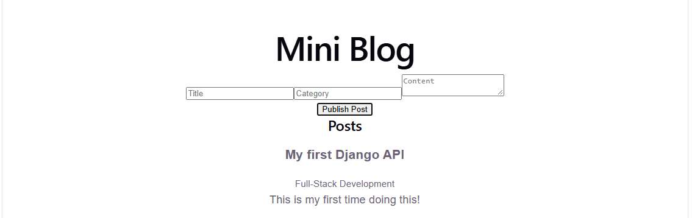
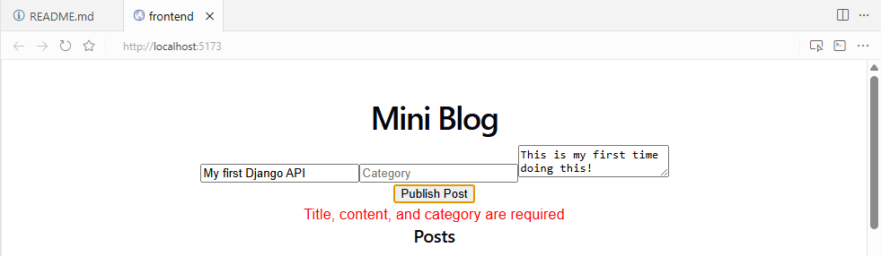
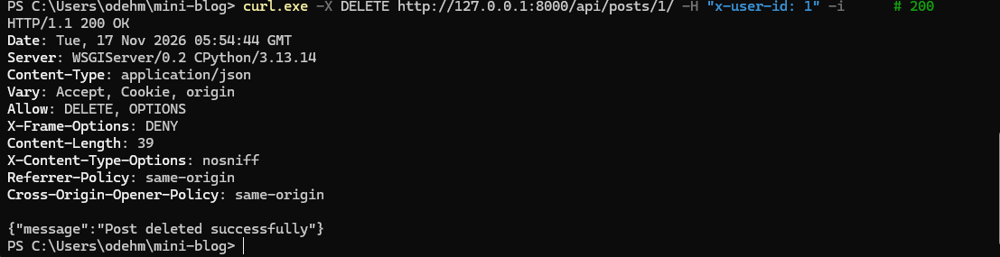
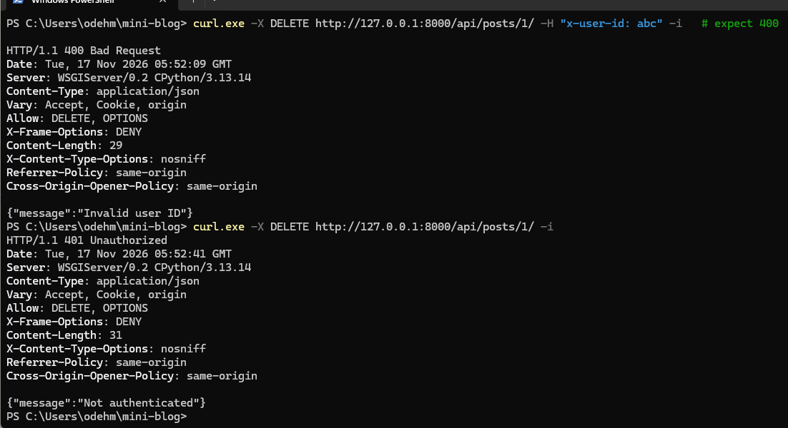
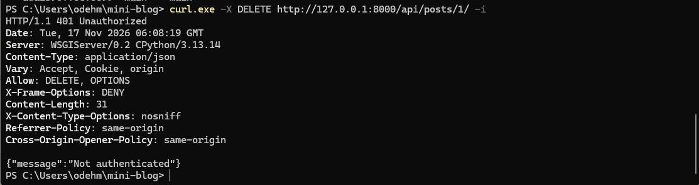
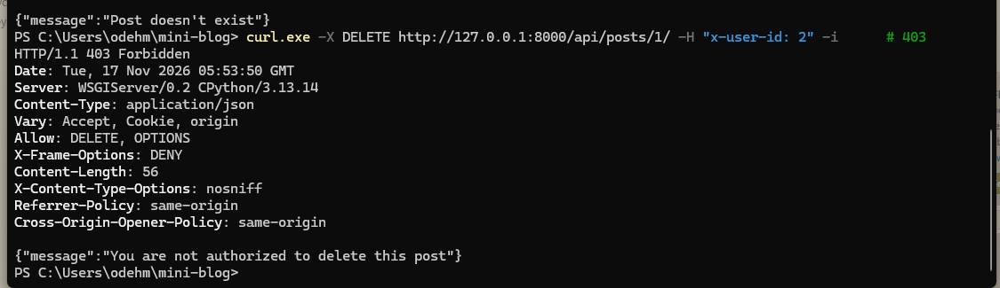
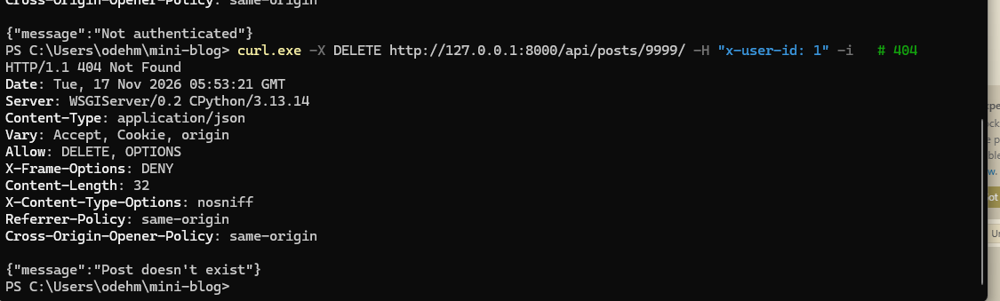

# Mini Blog

A small full-stack blog app built to practice REST APIs and debugging.

**Stack:** Django + Django REST Framework (backend), React + Vite (frontend), SQLite.

## Features
- List, create, and delete posts
- JSON API with validation and proper status codes (200, 201, 400, 401, 403, 404, 405)
- Ownership check: users can only delete their own posts

## Screenshots




## API


| Method | Endpoint | Description |
|---|---|---|
| GET | `/api/posts/` | List all posts |
| POST | `/api/posts/create/` | Create a post (requires `x-user-id` header) |
| DELETE | `/api/posts/<id>/` | Delete your own post (requires `x-user-id` header) |

### Delete endpoint responses

| Status | When |
|---|---|
| 200 OK | Post deleted |
| 400 Bad Request | `x-user-id` isn't a valid number |
| 401 Unauthorized | `x-user-id` header missing |
| 403 Forbidden | Post belongs to another user |
| 404 Not Found | No post with that id |
| 405 Method Not Allowed | Any method other than DELETE |

<details>
<summary>Example curl responses (screenshots)</summary>







</details>

## Run locally

Backend:
```
python -m venv venv
venv\Scripts\activate
pip install -r requirements.txt
python manage.py migrate
python manage.py runserver
```

Frontend (in a second terminal):
```
cd frontend
npm install
npm run dev
```
Open http://localhost:5173

## What I learned
- How a request moves from React to a Django view to the database and back
- Debugging with status codes, browser devtools and server logs
- Fixing real bugs I planted on purpose: field-name mismatches, a swallowed 500 error, serialization errors, missing headers and wrong URLs