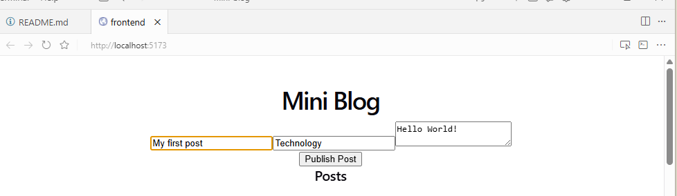
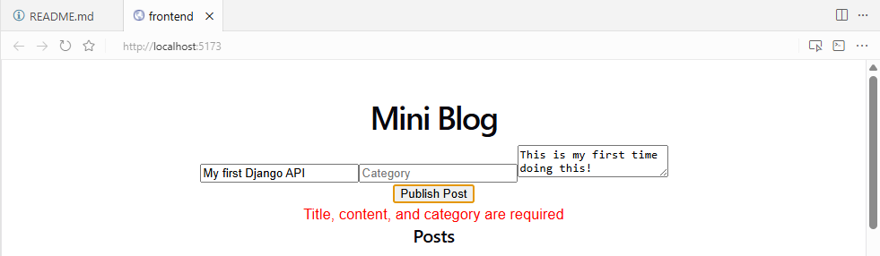

# Mini Blog

A small full-stack blog app built to practice REST APIs and debugging.

**Stack:** Django + Django REST Framework (backend), React + Vite (frontend), SQLite.

## Features
- List posts and publish new posts
- JSON API with validation and proper status codes (201, 400, 401, 405)
- CORS configured between the React app and the Django API

## Screenshots




## Run locally

Backend:
```
python -m venv venv
venv\Scripts\activate
pip install -r requirements.txt
python manage.py migrate
python manage.py runserver
```

Frontend (in a second terminal):
```
cd frontend
npm install
npm run dev
```
Open http://localhost:5173

## What I learned
- How a request moves from React to a Django view to the database and back
- Debugging with status codes, browser devtools and server logs
- Fixing real bugs I planted on purpose: field-name mismatches, a swallowed 500 error, serialization errors, missing headers and wrong URLs